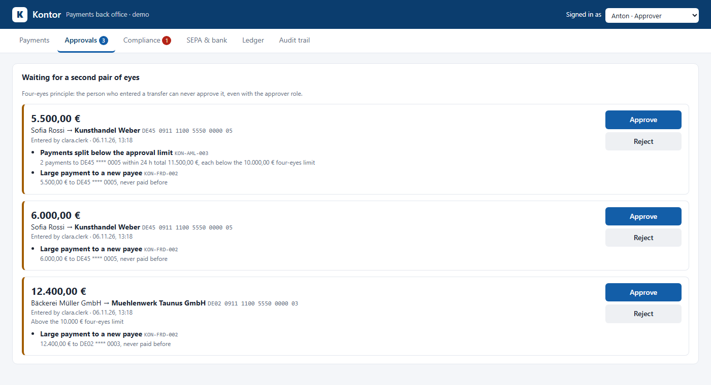
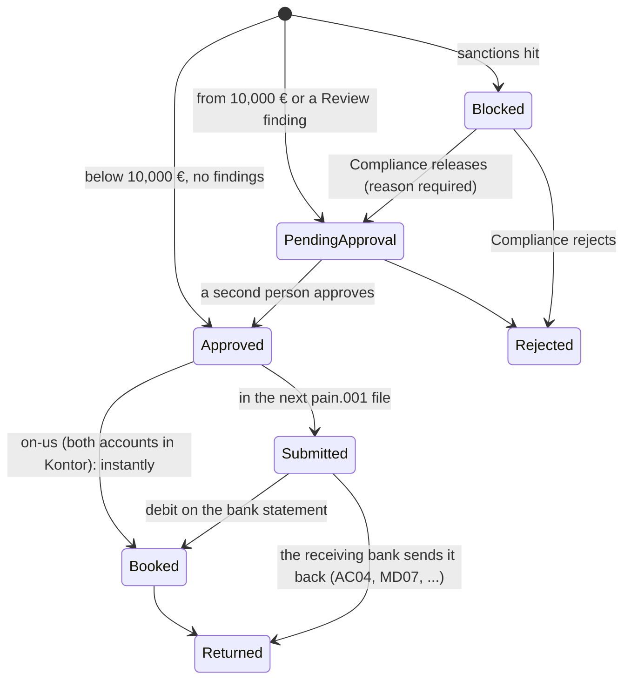
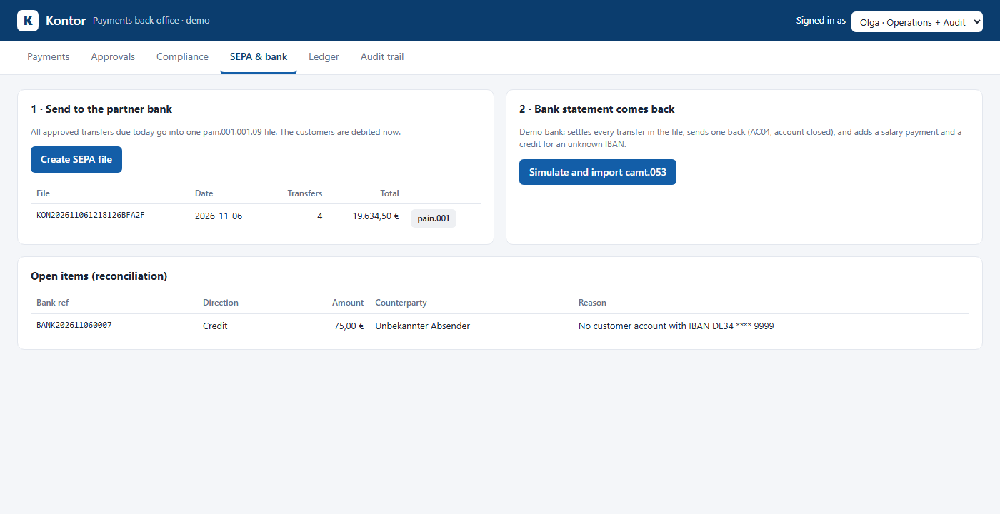
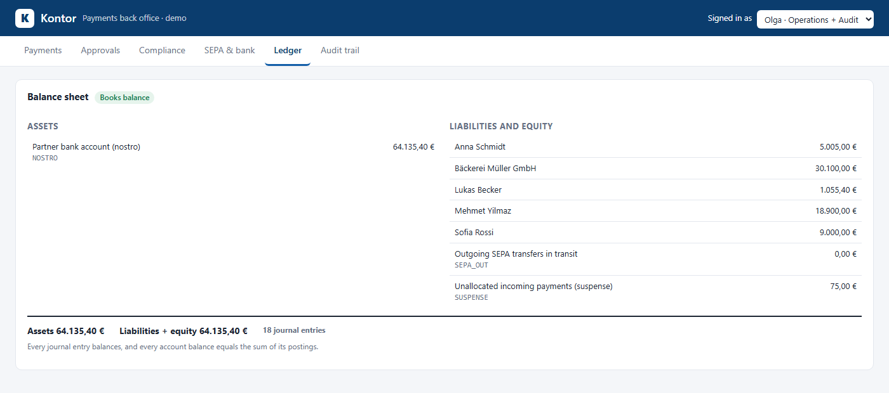
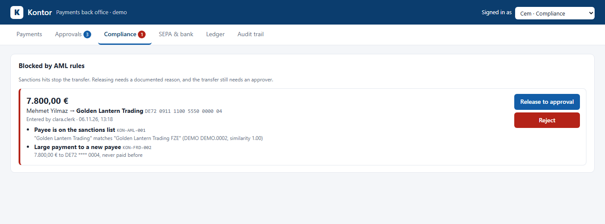

# Kontor

**A payments back office in ASP.NET Core 10: double-entry ledger, four-eyes approval, AML screening, Verification of Payee,
SEPA payment files (pain.001) and bank statement reconciliation (camt.053), with a tamper-evident audit trail.**



> 🇩🇪 **Kurzbeschreibung:** Kontor ist das Backoffice einer Zahlungsplattform, wie sie Fintechs und Banken-IT in Frankfurt
> bauen: doppelte Buchführung (Soll = Haben), Vier-Augen-Prinzip mit Funktionstrennung, Sanktionslisten-Screening und
> AML-Regeln (u. a. gestückelte Zahlungen unter der Freigabegrenze), Empfängerüberprüfung (Verification of Payee),
> SEPA-Überweisungsdateien im Format pain.001.001.09, Import von Kontoauszügen (camt.053) mit Rücklastschriften und
> Abgleich mit der Partnerbank, Idempotenz-Schlüssel gegen Doppelbuchungen und ein manipulationssicherer Audit-Trail
> (Hash-Kette). Die erzeugten XML-Dateien werden in den Tests gegen die offiziellen ISO-20022-Schemas validiert.

---

## Why this project

The other projects in my portfolio are security tools. Most .NET jobs in Frankfurt, though, are in banks, insurers and the
consultancies that build their systems, and there the security is *inside the business logic*: who may release a payment,
what happens when two requests spend the same balance, how you prove later that nobody changed a record. Kontor is that
kind of system, built small enough to read in an afternoon:

| Business rule | Why a bank cares | Where |
|---|---|---|
| Every booking balances (debit = credit), balances are re-checked against their postings | Money cannot appear or vanish; errors are found, not hidden | [`JournalRules`](src/Kontor.Domain/Ledger/Posting.cs), [`BalanceSheetAsync`](src/Kontor.Api/Services/AccountService.cs) |
| Four-eyes principle with segregation of duties | MaRisk: the person who enters a payment cannot release it | [`ApproveAsync`](src/Kontor.Api/Services/PaymentService.cs) |
| Sanctions screening (payees, incoming payers, new customers) | EU financial sanctions: no funds to listed persons | [`SanctionsList`](src/Kontor.Domain/Sanctions/SanctionsList.cs) |
| AML/fraud rules: split payments, velocity, new payee, unusual amount, high-risk country | KWG § 25h and GwG: banks must run systems that detect unusual transactions | [`RiskRules`](src/Kontor.Domain/Risk/RiskRules.cs) |
| Verification of Payee | EU Instant Payments Regulation, mandatory since 9 October 2025 | [`PayeeVerification`](src/Kontor.Domain/Banking/PayeeVerification.cs) |
| Idempotency keys, reservation of funds, serialized writes | A network retry or a double click must never pay twice or overdraw | [`CreateAsync`](src/Kontor.Api/Services/PaymentService.cs), [`UnitOfWork`](src/Kontor.Api/Services/Ledger.cs) |
| Hash-chained audit trail | Records must be provably unchanged (GoBD's immutability idea, DORA logging) | [`AuditChain`](src/Kontor.Domain/Audit/AuditChain.cs) |
| SEPA files and statement reconciliation | The ledger must show exactly what the bank shows, every day | [`SepaService`](src/Kontor.Api/Services/SepaService.cs) |

## Quick start

```bash
git clone https://github.com/karicamar/kontor && cd kontor
dotnet run --project src/Kontor.Api          # http://localhost:5080, with demo customers and payments
node demo/walkthrough.mjs                     # in a second terminal: one business day through the API
```

Open <http://localhost:5080>, switch between the four demo users at the top right and click through the day yourself:
approve as Anton, release or reject the sanctions hit as Cem, send the SEPA file and import the bank statement as Olga.
Or with Docker and PostgreSQL: `KONTOR_SIGNING_KEY=$(openssl rand -base64 48) KONTOR_DB_PASSWORD=$(openssl rand -hex 16) docker compose up --build` (port 8080).

The walkthrough prints ([full output](docs/walkthrough-output.txt)):

```text
== Four-eyes principle
  ✘ Clara approves her own 12.400,00 € transfer: 403 Four-eyes principle: a second person has to approve this payment
  ✔ Anton approves it: Approved
== AML: sanctions hit
  ✘ An approver cannot decide on it: 403 Only Compliance can decide on a blocked payment
  ✔ Compliance rejects it: Rejected, reserved money released
== Verification of Payee
  ✘ Lukas pays "Anna Schmitt": CloseMatch, did you mean "Anna Schmidt"?
  ✔ Network glitch, the app sends it again with the same Idempotency-Key: 200, same payment, booked once
== Bank statement (camt.053) comes back
  Credit      84,50 €  Transfer returned (AC04)
  Credit      75,00 €  Open item: No customer account with IBAN DE34 **** 9999
  ✔ Ledger nostro 64.135,40 € = bank closing balance 64.135,40 €
== Controls
  ✔ Balance sheet: assets 64.135,40 € = liabilities 64.135,40 €, 18 journal entries
  ✔ Audit trail: 24 hash-chained records, intact
```

## How a payment moves



1. **Entry** (role `clerk`). The request needs an `Idempotency-Key` header: the same key with the same body returns the
   same payment (`Idempotent-Replayed: true`), with a different body it is refused. Then:
   - **Validation**: IBAN (ISO 13616: country, length, mod-97 check digits, German BBAN format), SEPA reachability,
     amount (cents, at most 999,999,999.99), SEPA character set and lengths, execution date on the TARGET2 calendar
     (a Saturday becomes Monday; Good Friday and Easter Monday are holidays).
   - **Verification of Payee** for accounts held in Kontor: match, close match ("did you mean Anna Schmidt?") or no match.
     On *no match* the real holder is never shown, otherwise anyone could look up who owns an IBAN.
   - **Risk rules**, see below. The worst finding decides: `Block` → Blocked, `Review` → four-eyes.
   - **Reservation**: the amount is held on the account at once, so two payments cannot spend the same balance.
2. **Approval** (role `approver`): never by the person who entered it, and not by the compliance officer who released it.
   A user with both roles is still refused, and the attempt is written to the audit trail as `payment.self_approval_denied`.
3. **SEPA file** (role `operations`): all approved transfers due today go into one `pain.001.001.09` file. The platform's
   account at the partner bank is the debtor, the customer is the `UltmtDbtr`: that is how payment platforms on a partner
   bank work. The customer is debited now; the money waits in *Outgoing SEPA in transit*.
4. **Bank statement**: the `camt.053` from the partner bank is checked (right account, opening balance + entries = closing
   balance, not imported before) and matched by EndToEndId:
   - debit for a submitted transfer → **settled**;
   - credit with a return reason → **returned**, the customer gets the money back;
   - credit to a customer IBAN → **credited**, after screening the payer against the sanctions list;
   - anything else → booked to **suspense** and listed as an **open item** for a person.

   Afterwards the nostro account in the ledger must equal the bank's closing balance (reconciliation).



## The ledger

Double-entry bookkeeping with three internal accounts. Every journal entry has at least two postings that sum to zero
(debit = credit); balances are cached for speed but recomputed from the postings by the balance-sheet check.

| Event | Debit | Credit |
|---|---|---|
| Customer receives 2,840 € salary | Partner bank (nostro) | Customer |
| SEPA transfer leaves in the file | Customer | Outgoing SEPA in transit |
| Bank statement confirms it | Outgoing SEPA in transit | Partner bank (nostro) |
| Receiving bank returns it | Partner bank (nostro) | Customer |
| On-us transfer Lukas → Anna | Lukas | Anna |
| Credit for an unknown IBAN | Partner bank (nostro) | Suspense |

Customer accounts are liabilities (the platform owes its customers their money), so a debit lowers them. Assets always
equal liabilities: `GET /api/ledger/balance-sheet` proves it, and lists any account whose stored balance differs from its postings.



## AML and fraud rules

| Rule | Finding | Action |
|---|---|---|
| KON-AML-001 | Payee name on the sanctions list (similarity ≥ 0.92) / resembles an entry (≥ 0.85) | Block / Review |
| KON-AML-002 | Payee IBAN in a configured high-risk country | Review |
| KON-AML-003 | **Split payments**: several transfers to the same payee within 24 h, each below the 10,000 € approval limit, together above it | Review |
| KON-FRD-001 | 5+ payments within 10 minutes (account takeover) | Review |
| KON-FRD-002 | 5,000 € or more to an IBAN this customer has never paid (CEO fraud, invoice redirection) | Review |
| KON-FRD-003 | More than 5× the customer's largest payment of the last 90 days | Review |
| KON-VOP-001 | Sent although Verification of Payee said "no match" (authorised push payment fraud) | Review |

**Name matching** (sanctions and VoP) normalizes case, umlauts (`Müller` = `Mueller` = `Muller`), accents, punctuation, legal
forms (`GmbH`, `Ltd`, `FZE`) and titles, then compares word by word with Jaro-Winkler (tested against Winkler's published
values). Word order does not matter (`Musterow, Boris`), missing middle names and initials score lower but are still found.
The thresholds come from measured cases: `Anna Schneider` vs `Anna Schmidt` scores 0.915, so the VoP close-match
threshold is 0.93. Otherwise a different person would be shown the real holder's name.

The sanctions list is read in the **XML format of the EU Consolidated Financial Sanctions List**, so the real file can be
plugged in with `Kontor:SanctionsListPath`. The demo list ([`demo-sanctions.xml`](src/Kontor.Api/Data/demo-sanctions.xml)) contains only invented names.
Customers are screened when the account is opened: a clear hit is refused, a possible match opens the account frozen until
Compliance has checked it.



## Security

- **Authentication**: JWT bearer. In production `Auth:Authority` points to the identity provider (Entra ID, Keycloak) and only
  RS256/ES256 tokens are accepted; locally, `/dev/token` issues HS256 tokens. That endpoint and the simulated bank exist only
  in Development or with `Kontor:EnableDevTools`.
- **Authorization**: five roles (`clerk`, `approver`, `compliance`, `operations`, `auditor`); every endpoint requires a token
  (fallback policy), the business rules (four-eyes, compliance-only decisions) are enforced in the service, not just the UI.
- **Integrity**: bookings, status changes and audit records of one request are a single transaction. On SQLite writers are
  serialized (`BEGIN IMMEDIATE`). On PostgreSQL two requests can read the same account, so accounts and payments carry a
  concurrency token: the second `UPDATE` fails instead of overwriting the first (lost update), and the request is retried on
  fresh data, as is a race on a unique key (idempotency key, audit sequence). A test fires 20 parallel payments of 100 € at an
  account with 1,000 €: exactly 10 succeed, on both databases.
- **Audit trail**: each record holds the SHA-256 of its content and of the previous record. `GET /api/audit/verify` finds
  the first edited, deleted or reordered record. The test rewrites "who approved" directly in the database, and verification
  points at that record. Records are also written as JSON lines for a SIEM (`Kontor:AuditJsonlPath`).
- **XML**: DTDs are prohibited when reading statements and sanctions lists (no XXE), uploads are limited to 5 MB.
- **Data minimisation**: logs and audit details contain masked IBANs (`DE94 **** 0001`); the dashboard inserts every value as
  text (no `innerHTML`), with a strict Content Security Policy (`script-src 'self'`).
- **Errors**: RFC 9457 problem responses with documented types ([docs/errors.md](docs/errors.md)); unexpected errors reveal nothing.

## SIEM integration

With `Kontor:AuditJsonlPath` set, every committed audit record is also appended as one JSON line
(`{"timestamp":"…Z","source":"kontor","action":"payment.self_approval_denied","actor":"…",…}`).
[LogSentinel](https://github.com/karicamar/log-sentinel) reads these lines: rule `LS-FIN-001` alerts on attempts to approve
one's own payment, and its incident correlation links them by mailbox to a phishing mail ([PhishLens](https://github.com/karicamar/phishlens))
and a login from a new IP. A clerk who misunderstood the process becomes one Medium alert; a phished account trying to push a
transfer through becomes one Critical incident: *phishing → login from a new IP → self-approval attempt*.

```bash
logsentinel analyze src/Kontor.Api/kontor-audit.jsonl
  [Medium  ] clara.clerk tried to approve their own payment
             T1657 Financial Theft | 1 events
```

## API

| Method | Path | Role |
|---|---|---|
| `GET` | `/api/accounts`, `/api/accounts/{id}`, `/api/accounts/{id}/statement` | any |
| `POST` | `/api/accounts` | clerk |
| `POST` | `/api/accounts/{id}/freeze`, `/unfreeze` | compliance |
| `GET` | `/api/payments?status=`, `/api/payments/{id}` | any |
| `POST` | `/api/payments` (header `Idempotency-Key`) | clerk |
| `POST` | `/api/payments/{id}/approve` | approver |
| `POST` | `/api/payments/{id}/reject` | approver, compliance |
| `POST` | `/api/payments/{id}/release` | compliance |
| `GET`/`POST` | `/api/sepa/batches`, `GET /api/sepa/batches/{id}/pain001` | operations |
| `POST` | `/api/sepa/statements` (body: camt.053 XML) | operations |
| `GET` | `/api/reconciliation/open-items` | operations |
| `GET` | `/api/ledger/balance-sheet` | operations, auditor |
| `GET` | `/api/audit`, `/api/audit/verify` | auditor |

OpenAPI document at `/openapi/v1.json` in Development.

## Tests

```bash
dotnet test   # 148 tests
KONTOR_TEST_POSTGRES="Host=localhost;Username=postgres;Password=postgres" dotnet test   # the same suite on PostgreSQL
```

- **Against the official ISO 20022 schemas**: every generated `pain.001.001.09` and `camt.053.001.08` is validated with the
  XSDs from iso20022.org, so a wrong element order or a missing mandatory element fails the build.
- **Domain**: IBANs from the national example lists (and typos, transpositions, wrong lengths), Easter and TARGET2 holidays,
  SEPA character set, Jaro-Winkler against published values, every risk rule with and without a trigger, the audit chain
  under modification, deletion and "fixed" hashes.
- **API end to end** (real app in memory, controllable clock; CI runs everything on SQLite **and on PostgreSQL 17**): the full day from entry to reconciliation, four-eyes
  and compliance rules, Verification of Payee, idempotency, parallel overdraft attempts, duplicate and tampered statements,
  direct database tampering with the audit trail, role checks and forged tokens.

## Limits

- A demo, not a licensed core banking system: one currency (EUR), SEPA credit transfers only (no direct debits, no instant
  payments), no interest, fees or end-of-day closing.
- Runs on SQLite (no setup) or PostgreSQL (`Database:Provider=postgres`, used by `docker compose`). The schema is created
  with `EnsureCreated`; a production system would use EF Core migrations.
- Verification of Payee covers accounts held in Kontor; checking other banks would go through the EPC VoP scheme.
- The AML rules are examples of the kind of rules banks run, with configurable thresholds, not a complete AML system.

---

Built by **Amar Karic**: [GitHub](https://github.com/karicamar) · [LinkedIn](https://linkedin.com/in/amar-karic) ·
part of a portfolio with [SecureAuth API](https://github.com/karicamar/secure-auth-api),
[LogSentinel](https://github.com/karicamar/log-sentinel), [PhishLens](https://github.com/karicamar/phishlens),
[DepRadar](https://github.com/karicamar/depradar) and [HeaderGuard](https://github.com/karicamar/headerguard).
